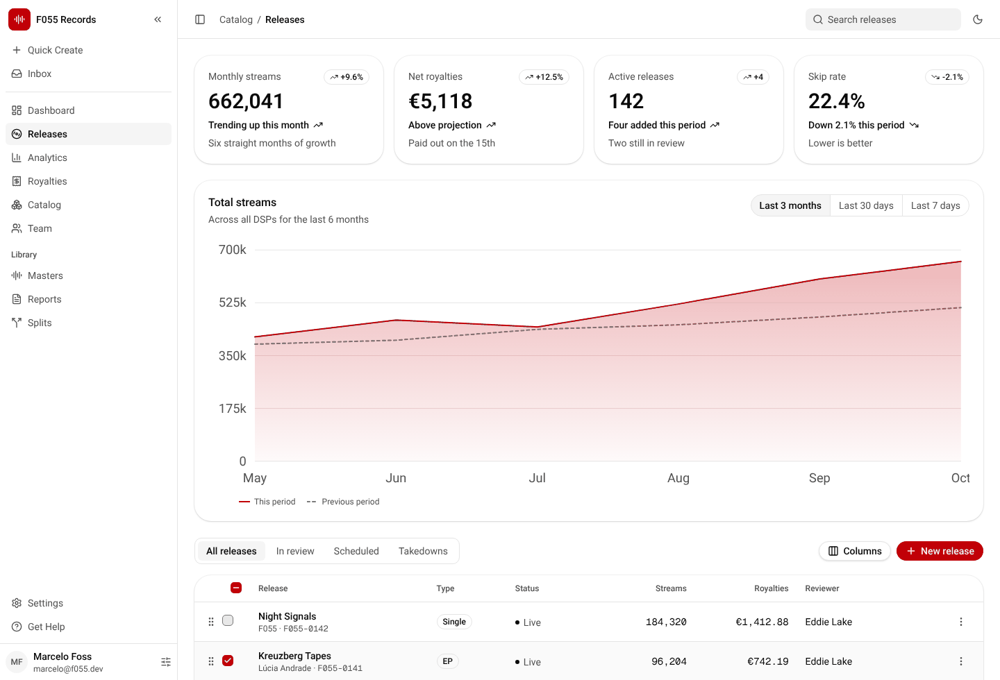
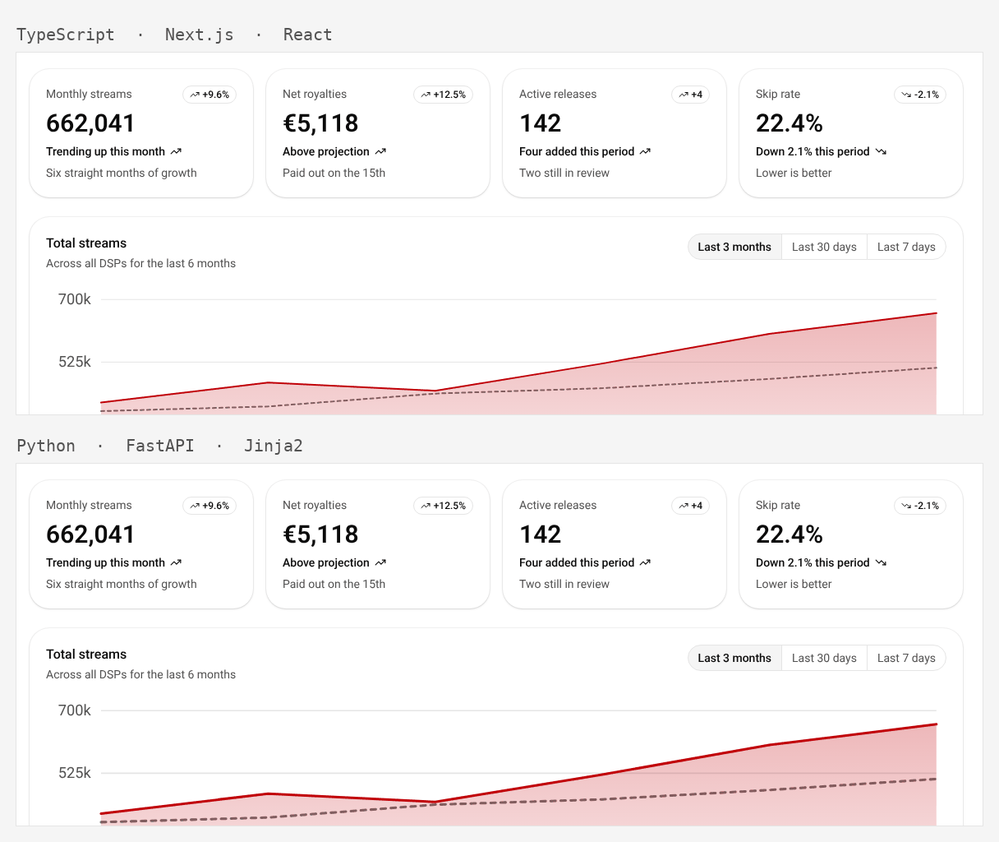
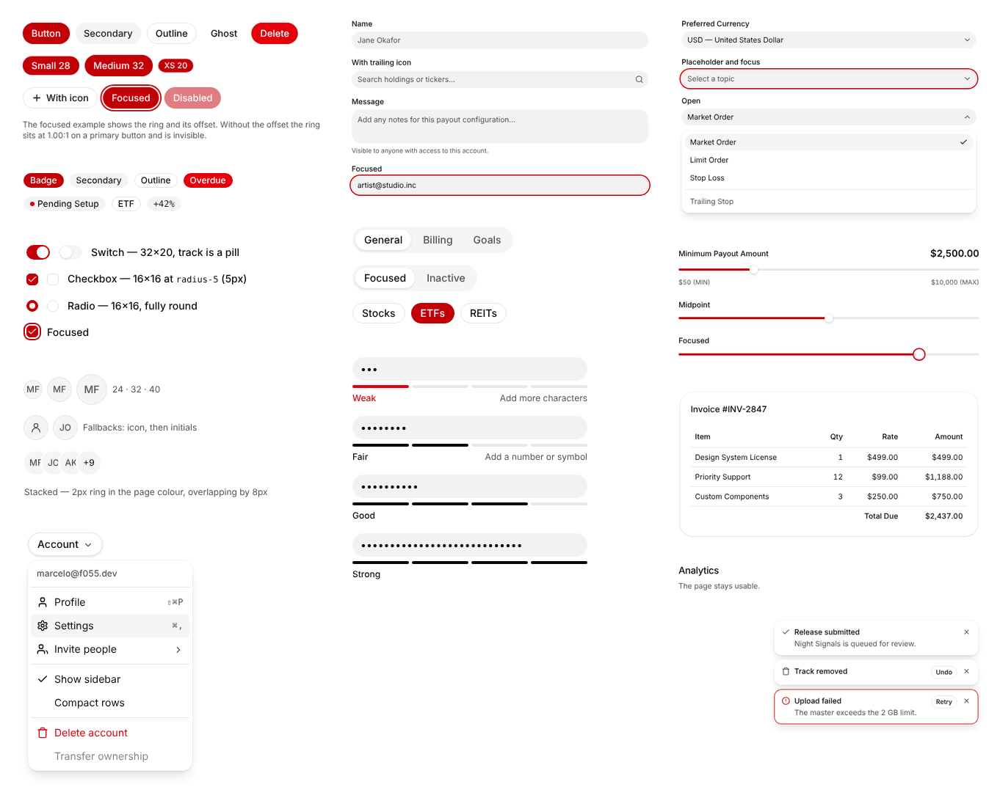

# F055 Design System

Tokens extracted from the Paper file **F055 Desys 1**, generated out to four
target stacks, with 40 component specs and two working implementations.

<picture>
  <source media="(prefers-color-scheme: dark)" srcset="docs/images/dashboard-dark.png">
  
</picture>

<sup>`examples/dashboard-next/` — every value on this screen comes from `dist/`.
The README renders the theme your system is set to.</sup>

**Defined: colour, typography, radius, spacing, size, elevation.** Colour,
typography, radius, spacing and elevation came out of the reference. **Size**
came out of building a real screen, and so did the split of data colour into a
sequential ramp and a categorical set. Motion is still undefined — a static file
cannot carry it — and so are page containers, grid gutters and breakpoints,
which belong to a screen rather than to a system.

Focus states are resolved: `ring` plus `ring-offset`, passing in both modes.
Every text node in all 40 specs and both screens is measured against WCAG AA, in
both themes, on every build.

## Layout

```
tokens/*.json              <- hand-edit: color, typography, radius,
                              spacing, size, elevation
components/<Name>/         <- 40 specs + live previews (hand-written)
examples/dashboard-next/   <- the same screen in Next.js
examples/dashboard-jinja/  <- and in FastAPI + Jinja2
scripts/build_tokens.py    <- regenerates everything below
scripts/check_tokens.py    <- every var() resolves; no raw values in previews
scripts/check_contrast.py  <- WCAG AA across previews and screens, both themes
scripts/_css.py            <- the small CSS reader those checks share
.github/workflows/         <- the above, as build gates
dist/
  web/tokens.css           <- Tailwind v4 (Next.js, Rails, FastAPI+Jinja2)
  web/tokens.js            <- Tailwind v3 config fallback
  python/tokens.py         <- FastAPI + Jinja2
  ruby/f055_tokens.rb      <- Rails
  kotlin/F055Colors.kt     <- KMP: colours + theme wrapper
  kotlin/F055Type.kt       <- KMP: type styles
  kotlin/F055Shapes.kt     <- KMP: radii
  swift/F055Tokens.swift   <- native SwiftUI surfaces only
  artifact/tokens.json     <- feeds the browsable design system page
  tokens.flat.json         <- resolved values, for any other consumer
CLAUDE.md                  <- rules for Claude CLI and other AI-assisted coding
```

## Build

```sh
python3 scripts/build_tokens.py
```

No dependencies — standard library only.

## What the system is

A near-monochrome system. Everything structural is neutral grey; a single red
ramp carries brand, action and data. There is no second hue.

The practical consequence: **red means action or data, never decoration.** A red
surface here is a button you can press or a value you can read.

Three more things define the look. Every interactive control is a **pill** —
18px radius against control heights of 20–32px, so they render fully rounded;
cards sit at 24px. The type scale is **tight**: six steps, 12 through 30px, with
no 20px step at all. And surfaces are defined by a **crisp 1px edge** rather
than by lift — every elevation is a hairline ring with a drop shadow doing very
little behind it.

## Using the tokens

Pick a token by the **role** it plays, not by how it looks.

Always pair a surface with its own foreground — `primary-foreground` on
`primary`, `card-foreground` on `card`. Those pairings are contrast-checked;
ad-hoc combinations are not. Putting plain `foreground` on `primary` is the most
common way to break this system.

One `primary` per view. If two things on screen are both primary red, neither
reads as the main action.

`muted` and `accent` currently resolve to the same value. They are still two
tokens — use the one that matches intent, so they can diverge later without a
find-and-replace.

Use a **named type style** (`label`, `button`, `eyebrow`, `numeric`) rather than
a raw size. The style bundles family, size, line height, weight and numeral
behaviour, which is what keeps a label in a Rails form and a label in a Compose
screen looking like the same thing.

The chart ramp runs light to dark, `chart-1` through `chart-5`. Use it in order.

## Sizes

`tokens/size.json` — twelve steps (4, 6, 8, 12, 14, 16, 20, 24, 28, 32, 40, 64)
and eighteen named roles on top of them. The steps are named by pixel value, as
radius and spacing are, because they form no consistent ratio; the roles are the
counterpart to radius's `pill`/`full`, so a button does not have to be
remembered as 32.

They were prose under `controlHeights` in `tokens/radius.json` from the first
extraction, flagged as "not yet tokens" in every README since. The values come
from a frequency tally across all forty previews: 16px appears 124 times, 20px
65, 32px 40, 28px 24, 24px 18. 36, 48 and 80 appear once or twice and were left
out.

Reach for the role, not the step — `--control-button`, not `--size-32`. When a
density variant arrives the role moves and the call sites do not.

Layout widths are deliberately absent. A 256px sidebar or a 1200px content
column belongs to a screen, not to the system; see below on why no containers or
breakpoints were taken from the reference.

## Data colour

Two families doing two different jobs. `chart-1..5` is a **sequential** ramp for
magnitude — the dark ramp is the light one reversed, so step 1 is always nearest
the surface and step 5 always the most prominent, in both themes. `series-1..3`
is the **categorical** set for identity: brand red, full ink, muted ink.

The split came out of building the dashboard. The five chart tokens were
theme-invariant and, measured against 3:1, yielded exactly one usable mark
colour. A one-hue palette cannot do categorical work by hue, so the third slot
carries a hard requirement — a distinct mark type — and there is no fourth.

## Contrast is checked, not asserted

`scripts/check_contrast.py` resolves the cascade, composites alpha, and measures
every text node against WCAG AA in both themes. Standard library only, so CI
needs no browser. It covers two things:

- the **40 component previews**, which carry their own `<style>` block
- the **two built screens** — Tailwind's real minified output, and the markup
  React and Jinja actually produce

The second half matters because the first is not enough: the specs being
accessible says nothing about the screens assembled from them. Dark mode needs
no second parse, because neither example uses a single `dark:` variant — the
semantic tokens flip under `.dark` on their own, so the same markup is measured
twice, once against each mode's values.

It also **tests itself before it tests anything else.** Six fixtures assert that
it still catches what it is for, because a checker that cannot fail is worse than
no checker: it reads as evidence and carries none. That is not hypothetical —
the first version of the screens half compared the whole at-rule prelude, so
`@layer utilities` never matched `@layer`, Tailwind's entire utility layer was
discarded, and both screens reported a clean pass while every text node was
being measured against bare paper. A fixture that passes only when a background
is read out of `@layer utilities` now guards that exact hole, and a second guard
fails the run outright if a screen's stylesheet yields almost no colour rules.

It found thirty failures the first time it ran, in three groups, and all three
turned into token changes rather than into documentation:

| What | Was | Now |
|---|---|---|
| `muted-foreground` in light | neutral.500 — 4.35:1 on muted, 4.24:1 on input | **neutral.600** — 7.17 and 6.98 |
| A destructive button's own label | red.50 on red.500/600 — **3.48:1 in dark** | white on red.600 — 4.77 both themes |
| Destructive used as ink | the same token as the fill | **`destructive-text`**, red.600 / red.500 |

The first of those reverses a call made earlier the same day. The reasoning had
been that 4.35 vs 4.5 is a rounding-level miss on an extracted value, better
prohibited than corrected. The measurement showed the pair in seven components —
avatar initials, chip initials, card labels, placeholder text — so it was not an
edge case to prohibit but a value the system leans on.

## Design decisions worth knowing

**Naming follows shadcn/ui v4** for colour. The reference already used those
names, so the web output drops into any shadcn project unchanged, and the Kotlin
and Swift outputs stay recognisable to anyone who has seen the web side.

**The reference is built on Tailwind primitives throughout.** All six type steps
match Tailwind's defaults exactly. So do all eleven spacing steps (0.5 through
10). So do the shadows — `card` and `thumb` are `shadow-sm`, `raised` is
`shadow-md`, each with a ring added. A Tailwind project therefore needs almost
no configuration; everything is written out anyway so the other three stacks
share the same numbers.

**Radius is eight values, not a scale.** 5, 6, 8, 10, 14, 18, 24 and full have
no consistent ratio, so they are named by pixel value — with `pill` (18px) and
`full` keeping intent names, because those denote a shape rather than a size.

**Elevation is six levels, and `hairline` is the most-used of all** — a 1px ring
in the border colour with no drop, for elements that need an edge but no lift.
It is a shadow rather than a border so it costs no layout.

**Spacing is a 2px grid, not 4px.** 2, 6, 10 and 14 are all in real use, and
there is no 32px step — the scale jumps 24 → 40. 20px is the card unit: both a
card's inner padding and the gap between its parts. Tokens are named by pixel
value (`space-20`), not by Tailwind step, because step names are fractional and
`var(--space-1.5)` is not a valid identifier without escaping; each token
records its Tailwind step in a field instead.

**Values are faithful to the reference, including its quirks.** `primary` is
darker in dark mode than light. `secondary` sits on a zinc ramp while everything
else is neutral. Two type styles land on fractional pixels. All preserved, all
flagged.

**`muted-subtle` is `muted` at 50%** — the fill under ListGroup rows, Accordion
items and Alerts. Measured at `#F5F5F580` light and `#26262680` dark; one step
lighter than `muted`, which is what stops a stack of rows reading as a wall of
grey.

**`track` was the first colour token added after the first pass.** The empty half
of a slider and the fill of an unchecked checkbox use `#E5E5E5E6` light and
`#FFFFFF22` dark — a third alpha ramp, distinct from both `border` (10% dark)
and `input` (15%). The values are extracted; only the name is mine.

**Provenance is recorded per token.** `extracted` means measured from the file;
`derived` means I filled it in. Five colour tokens are derived — `popover`,
`popover-foreground`, `destructive`, `ring` and `ring-offset`.

**Focus states need the offset.** `ring` is red, and so are `primary` and
`destructive`, so a ring drawn straight onto either of those buttons sits at
1.00:1. `ring-offset` puts a band of page colour in between. Every focus state
uses both tokens; one without the other is a bug.

## Consuming F055 in a project

Everything under `dist/` is generated from `tokens/` by
`python3 scripts/build_tokens.py`. Nothing under `dist/` is edited by hand.

**Never write a raw design value in application code** — no hex, `rgb()` or
`oklch()`; no Tailwind palette utilities like `bg-red-600`; no raw `font-size`,
`line-height`, `font-family`, `border-radius` or `box-shadow`. If no token fits,
add one under `tokens/` and rebuild rather than inlining a literal.

### Focus states

Every focusable control draws both tokens, always together:

```html
<button class="... focus-visible:ring-2 focus-visible:ring-ring
               focus-visible:ring-offset-2 focus-visible:ring-offset-ring-offset">
```

Or in hand-written CSS, as two shadows so the ring stays outside the box model:

```css
box-shadow: 0 0 0 2px var(--ring-offset), 0 0 0 4px var(--ring);
```

`:focus-visible`, not `:focus`, so pointer users don't see rings on click.

### TypeScript · Next.js · Tailwind

Tailwind v4 — import the stylesheet once, after `@import "tailwindcss";`:

```css
@import "tailwindcss";
@import "../design-system/dist/web/tokens.css";
```

Every token is then a utility: `bg-background`, `text-muted-foreground`,
`border-border`, `ring-ring`, `fill-chart-1`, `font-mono`, `text-sm`,
`rounded-pill`, `rounded-xl`, `shadow-card`, `shadow-raised`.

Spacing needs no configuration — the eleven steps are exactly Tailwind's own, so
`p-5` is the card padding and `gap-1.5` the button gap.

**The stylesheet declares the font families but does not load them.**
`--font-sans` and `--font-mono` name Roboto and Geist Mono with fallback stacks;
nothing fetches the faces. Without this line you silently get the fallbacks,
which is a visible downgrade that no check will catch:

```css
@import url('https://fonts.googleapis.com/css2?family=Roboto:wght@400;500;600&family=Geist+Mono:wght@400;500&display=swap');
```

Those are the only weights the system uses — Roboto 400/500/600, Geist Mono
400/500. Self-host instead if you prefer; the point is that loading is the
consumer's job on every platform, KMP and SwiftUI included.

The file also defines `.type-*` classes (`type-label`, `type-display`,
`type-numeric`) that bundle family, size, line height, weight and numerals. In a
template those save repeating four utilities on every label; in React, composing
utilities or wrapping a component is equally fine. Pick one approach per project
— mixing both makes the type layer impossible to audit.

Tailwind v3 projects consume `dist/web/tokens.js` from the config instead.

### Python · FastAPI · Jinja2 · Tailwind

Styling goes through the same Tailwind classes. Use `dist/python/tokens.py` only
when a value must exist server-side — mailers, generated SVG or charts, PDF
export, a `theme-color` tag:

```python
from design_system.tokens import jinja_globals
templates.env.globals.update(jinja_globals())
```

```jinja
<meta name="theme-color" content="{{ colors.light.background.hex }}">
<span style="{{ type.label.css }}">Email</span>
```

`.css` on a text style emits an inline declaration — the only thing that works
in email, where classes do not apply.

### Ruby on Rails · Tailwind

Same split. Views use the Tailwind classes; `dist/ruby/f055_tokens.rb` covers
mailers, generated SVG and PDF export:

```ruby
F055::Tokens.scheme(:dark)[:background].hex  # => "#0A0A0A"
F055::Tokens::TYPE[:label].css
F055::Tokens::RADIUS[:pill]                  # => "18px"
```

Unknown scheme names fall back to light rather than raising, so a bad param
cannot take a page down.

### KMP · iOS · Android · Web

```kotlin
F055Theme(dark = isSystemInDarkTheme(), sans = robotoFamily, mono = geistMono) {
    // LocalF055Colors.current, LocalF055Type.current, F055Space, F055Radius
}
```

Pass real `FontFamily` values — the defaults fall back to system faces, which is
a visible downgrade. `MaterialTheme` is wired up (colours, typography, shapes)
for Material 3 components, but Material's slots cannot express `muted`, the
chart ramp, or styles like `eyebrow`; go through the F055 locals for those.

Two platform caveats: Compose has no `textTransform`, so `eyebrow` carries none
— uppercase at the call site. And `F055Elevation` only approximates the
shadows, drawing the hairline ring as a border that affects layout.

`dist/swift/F055Tokens.swift` is for native SwiftUI surfaces outside the shared
module — widgets, App Clips, a host screen. Shared UI belongs in Kotlin so both
platforms move together.

### AI-assisted coding

`CLAUDE.md` carries these rules written for an agent, plus the greps that catch
violations and the two commands that must be run after any token change.

## Examples

Two implementations of the same screen, a dashboard modelled on shadcn's
dashboard-01:

| | Stack | Run |
|---|---|---|
| `examples/dashboard-next/` | Next.js + Tailwind v4 + lucide-react | `npm install && npm run dev` |
| `examples/dashboard-jinja/` | Python + FastAPI + Jinja2 + Tailwind v4 | `pip install -r requirements.txt && npm run build && uvicorn app:app` |

The same region of the same screen, built twice:



The second implementation exists to test whether the system survives a stack
that is not React. It does — the size roles, the colour tokens and the named
type styles all travelled unchanged, and the server-rendered page carries no
client JavaScript at all.

What did **not** travel is the components. The Jinja macros and the React
components share every token and no code. That was the prediction in "On
components" below, and building the second implementation confirmed it rather
than disproving it.

Both examples exist to be tests, and both found things. The token file dropped
into Tailwind v4 with no adapter, and `track` and `muted-subtle` both earned
their keep. Against that:

| Found by building | Outcome |
|---|---|
| `rounded-xl` resolved to Tailwind's 12px, not any F055 radius | the generator now clears Tailwind's radius, shadow and text scales, so an off-system utility produces no CSS at all |
| the five chart tokens yielded one usable colour at 3:1 | split into sequential `chart-*` and categorical `series-*` |
| every control dimension was a literal | `tokens/size.json` |
| `muted-foreground` on `muted` was 4.35:1 | the light ink darkened to neutral.600 |
| `border` was too faint to outline a checkbox | `border-strong` |
| a destructive button's own label was 3.48:1 in dark | `destructive` split into fill and `destructive-text` |
| `jinja_globals()` did not expose the size family | fixed before a template was written |

Each example's README carries the full list with the measurements.

## On components

Tokens travel across all four stacks. Components do not: a button in Jinja2,
ERB, React and Compose is four implementations. What can realistically be shared
is this token layer plus a written spec per component — anatomy, states, and
which tokens each part uses — with four thin implementations under it.

<picture>
  <source media="(prefers-color-scheme: dark)" srcset="docs/images/components-dark.png">
  
</picture>

<sup>Twelve of the forty, rendered from `components/<Name>/preview.html` against
the real token file.</sup>

That spec now exists for all forty. Each one is a `README.md` — anatomy,
variants, which token every part uses, and the decisions that are easy to get
wrong — beside a `preview.html` that renders it from `dist/web/tokens.css`. The
previews are not illustrations: `check_tokens.py` fails the build if one uses a
raw value or an undefined class, and `check_contrast.py` measures every text
node in them.

The overlay set — Menu, Dialog, Drawer, Toast, on top of Popover — settles two
rules the rest of the system depends on. **Radius follows size; shadow follows
whether it floats**: Menu, Popover and Toast take `radius-14`, Dialog and Drawer
take `radius-24`, all five take `shadow-overlay`. And a **scrim is
`var(--foreground)` at 50% opacity**, never a new colour, so it inverts with the
theme — a dark scrim over a dark page does not read as a scrim at all.

Those three overlays are also the weakest provenance here. The reference has an
"Alert Dialog" button and draws no dialog; a page-wide search for a scrim fill
found nothing. Treat Dialog, Drawer and Toast as proposals.

Motion arrived with this set, in exactly two places. Spinner needs it to be a
spinner, and the reference's skeleton bars carry opacities of 0.892, 0.881,
0.869 and 0.857 — one staggered pulse caught mid-frame, which is the only
animation the file implies anywhere. Both are hard-coded durations; there is
still no motion token, and two components is not yet enough to design one from.

What is *not* there, and should not be invented from this reference, is layout:
the source is a 3000px presentation artboard with seven columns of 375px
specimen cards. That is how a designer arranged a catalogue for viewing, not an
application layout. Containers, gutters and breakpoints belong to the first real
screen in a real stack.

## Open decisions

1. **Destructive and primary are both red.** Still open, and the one decision
   measurement cannot settle. The reference never defined a destructive
   colour — its "Danger Zone" row uses plain `foreground` — and because the
   brand *is* red, a destructive button still looks much like a primary one.
   Contrast is no longer the problem: `destructive` carries white at 4.77:1 in
   both themes, and `destructive-text` clears AA as ink. What remains is that
   two red buttons side by side do not say which one is dangerous. Until a
   non-red destructive is chosen, the words carry it — a dialog title states the
   consequence and the button names the act, never "Are you sure?" and "OK".

2. **A fourth categorical series has nowhere to go.** The ramp question is
   settled — `chart-*` is sequential, `series-*` is categorical, and three slots
   are validated. But three is the ceiling a one-hue palette allows, so a fourth
   series has to fold into "Other" or become a facet. A product that genuinely
   needs five categories needs a second hue, which is the same decision as 1.

3. **Two type styles are fractional.** `prose` at 22.75px and `label` at
   19.25px. Round to 23/19, or normalise to 24/20 for a 4px grid.

4. **`space-10` is thin** — two uses, both as input inner padding. Kept because
   inputs matter, but it is not a general step.

5. **Compose cannot reproduce the elevation shadows.** Each level is a hairline
   ring plus coloured drops; Compose offers a single `shadow(dp, shape)`. The
   Kotlin output approximates and turns the ring into a border, which — unlike
   the CSS version — affects layout. SwiftUI reproduces the drops faithfully but
   draws the ring as an inset stroke.

## Verifying against the source

Light reference: artboard `D5-0` · Dark: `3JI-0` · Palette cards: `1O9-0` /
`2LV-0` · Type specimen: `1PS-0`, in Paper file `01M5M3N461Y0VSS854R6G5S86K`.

`Archivo` was declared in that file's font list and used on zero nodes, so it was
never tokenised. It has since been removed from the file, which settles it.

The file also had a fifth artboard, "Hello World" (1440×900) — the one place a
horizontal nav bar would plausibly have lived. It was deleted before it could be
examined, which is why NavBar is derived rather than extracted.

The browsable version of this system — the same tokens with live component
previews in both themes — is published as a Claude design-system artifact. Its
prose is a presentation layer; this file and `CLAUDE.md` are the source of
truth, and the artifact's token data comes from `dist/artifact/tokens.json`.
